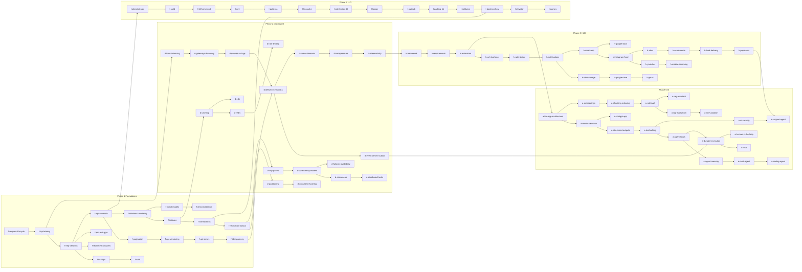

# Curriculum

**89 lessons · 5 phases · 14 weeks · ~7–9 hours/week**

Every lesson must justify its existence. A lesson is included only if it passes
all five filters: interview relevance, foundational importance, dependency
necessity, transferability to unfamiliar problems, and depth (it must have
something non-obvious to teach). Topics that failed these filters are listed in
"Deliberately excluded" at the bottom.

## Size justification

| | |
| --- | --- |
| Lessons | 89 |
| Median lesson | 35 min learn + 15 min exercise + 5 min revision ≈ 55 min |
| Heavy lessons (HLD designs, ~15) | ~90 min |
| Total learning time | ≈ 105–115 hours |
| Over 14 weeks | ≈ 7.5–8.2 h/week |

That is realistic alongside a full-time engineering job. Adding a sixth phase or
a 130-lesson catalogue would not be.

---

## Phase map

| Phase | Weeks | Lessons | Outcome |
| --- | --- | --- | --- |
| 1 · Foundations | 1–3 | 18 | Can reason about the network, an API contract, and a data model without hand-waving. |
| 2 · Backend & Distributed Systems | 4–6 | 19 | Can name the component that solves a given problem, and the cost it introduces. |
| 3 · High Level Design | 7–10 | 18 | Can derive an architecture for a named system under time pressure. |
| 4 · Low Level Design | 11–12 | 14 | Can go from requirements to classes, interfaces and working core logic. |
| 5 · AI Agent & Workflow System Design | 13–14 | 20 | Can design a production LLM/agent system and defend its failure handling. |

---

## Phase 1 — Foundations (18 lessons, weeks 1–3)

### Module 1.1 — Networking (6)

| # | Slug | Title | Min | The non-obvious thing it teaches |
| --- | --- | --- | --- | --- |
| 1 | `f-request-lifecycle` | How a request actually travels | 45 | **CANONICAL.** Every hop between typing a URL and receiving bytes, and which hop each later component (CDN, LB, gateway) is inserted into. |
| 2 | `f-tcp-latency` | TCP, connections, and why latency is not bandwidth | 40 | Round trips, not megabits, dominate perceived performance; connection reuse is a design decision. |
| 3 | `f-http-versions` | HTTP/1.1 → HTTP/2 → HTTP/3 | 35 | HTTP semantics are stable; only the transport changed. Head-of-line blocking moved, it did not disappear. |
| 4 | `f-tls-https` | TLS and HTTPS: what it protects, what it costs | 35 | What terminating TLS at the edge actually gives up, and why mTLS shows up between services. |
| 5 | `f-realtime-transports` | Polling, long polling, SSE, WebSockets | 45 | Choosing a transport is a server-state decision, not a latency decision. |
| 6 | `f-rpc-rest-grpc` | REST vs RPC vs gRPC vs GraphQL | 40 | Protocol choice follows the client/consumer relationship, not fashion. |

### Module 1.2 — APIs (6)

| # | Slug | Title | Min | The non-obvious thing it teaches |
| --- | --- | --- | --- | --- |
| 7 | `f-api-contracts` | Resource modelling and API contracts | 40 | An API is a compatibility promise; modelling errors are expensive because the contract outlives the code. |
| 8 | `f-pagination` | Pagination, filtering, sorting at scale | 40 | Offset pagination is a correctness bug at scale, not just a slow query. |
| 9 | `f-api-versioning` | Versioning and evolution | 35 | Most "versioning" problems are really additive-change discipline problems. |
| 10 | `f-api-errors` | Errors, status codes, partial failure | 35 | Errors are part of the contract; ambiguous failures force clients into unsafe retries. |
| 11 | `f-idempotency` | Idempotency and safe retries | 45 | Idempotency keys, dedup windows, and why "exactly once" is a client-side illusion. |
| 12 | `f-auth` | Sessions, JWT, OAuth2/OIDC | 50 | Statelessness buys scale and costs revocation. |

### Module 1.3 — Databases (6)

| # | Slug | Title | Min | The non-obvious thing it teaches |
| --- | --- | --- | --- | --- |
| 13 | `f-relational-modeling` | Relational modelling and normalisation | 45 | Normalise to find the truth, denormalise deliberately and with an owner. |
| 14 | `f-indexes` | Indexes and query performance | 50 | B-tree shape, composite column order, covering indexes, and the write cost of every index. |
| 15 | `f-transactions` | Transactions, ACID, isolation levels | 50 | Which anomaly each isolation level actually permits, and what your database defaults to. |
| 16 | `f-nosql-models` | NoSQL models and access-pattern-first design | 45 | You do not choose NoSQL for scale; you choose it for an access pattern and pay in flexibility. |
| 17 | `f-denormalization` | Denormalisation and derived data | 40 | Every derived copy needs an owner, a rebuild path, and a staleness budget. |
| 18 | `f-replication-basics` | Replication and read scaling | 45 | Read replicas move the problem to replication lag, which is now your correctness problem. |

---

## Phase 2 — Backend & Distributed Systems (19 lessons, weeks 4–6)

### Module 2.1 — Serving and caching (5)

| # | Slug | Title | Min | The non-obvious thing it teaches |
| --- | --- | --- | --- | --- |
| 19 | `d-caching` | Caching: where, what, and invalidation | 50 | Cache placement decides your failure mode; invalidation strategy decides your correctness. |
| 20 | `d-redis` | Redis in practice | 50 | Redis is a data-structure server; the structure you pick *is* the design. |
| 21 | `d-cdn` | CDN and edge caching | 40 | Cache keys, `Vary`, and why personalisation destroys edge cacheability. |
| 22 | `d-load-balancing` | Load balancing: L4 vs L7 | 45 | Health checks and connection draining matter more than the algorithm. |
| 23 | `d-gateways-discovery` | Reverse proxies, API gateways, service discovery | 40 | What belongs at the edge and what must not be centralised there. |

### Module 2.2 — Data at scale (5)

| # | Slug | Title | Min | The non-obvious thing it teaches |
| --- | --- | --- | --- | --- |
| 24 | `d-partitioning` | Partitioning and sharding | 55 | Choosing a partition key is choosing your future hot spots and your cross-shard queries. |
| 25 | `d-consistent-hashing` | Consistent hashing and virtual nodes | 40 | Why naive `hash % N` makes resharding an outage. |
| 26 | `d-cap-pacelc` | CAP, PACELC, and what "consistency" means | 45 | CAP is about behaviour during a partition only; PACELC covers the other 99.9% of the time. |
| 27 | `d-consistency-models` | Linearizable → causal → eventual | 50 | The model you need is usually per-operation, not per-database. |
| 28 | `d-consensus` | Consensus, leader election, quorums | 50 | Quorum arithmetic (`R + W > N`), and why consensus is expensive enough to keep off the hot path. |

### Module 2.3 — Asynchrony and messaging (4)

| # | Slug | Title | Min | The non-obvious thing it teaches |
| --- | --- | --- | --- | --- |
| 29 | `d-queues-vs-logs` | Message queues vs log-based brokers | 50 | Kafka and RabbitMQ solve different problems; retention and replay are the dividing line. |
| 30 | `d-delivery-semantics` | Delivery semantics and ordering | 45 | "Exactly once" is at-least-once delivery plus idempotent processing. |
| 31 | `d-event-driven-outbox` | Event-driven architecture, outbox, CDC | 50 | The dual-write problem, and the two standard ways out of it. |
| 32 | `d-rate-limiting` | Rate limiting algorithms and distributed enforcement | 50 | Token bucket vs sliding window, and the cost of making a limiter globally accurate. |

### Module 2.4 — Resilience and operations (5)

| # | Slug | Title | Min | The non-obvious thing it teaches |
| --- | --- | --- | --- | --- |
| 33 | `d-distributed-locks` | Distributed locks and leases | 45 | A lock without fencing is a data-corruption bug waiting for a GC pause. |
| 34 | `d-retries-timeouts` | Timeouts, retries, backoff, hedging | 45 | Retries are a load amplifier; budgets and jitter are not optional. |
| 35 | `d-backpressure` | Backpressure, load shedding, circuit breakers | 45 | Queues do not absorb overload, they hide it until latency collapses. |
| 36 | `d-failover-availability` | Failover, topologies, availability arithmetic | 45 | Serial dependencies multiply failure; every nine costs an order of magnitude. |
| 37 | `d-observability` | Logs, metrics, traces, SLOs | 45 | Design the three signals *into* the architecture; percentiles, not averages. |

---

## Phase 3 — High Level Design (18 lessons, weeks 7–10)

### Module 3.1 — Method (3)

| # | Slug | Title | Min | Focus |
| --- | --- | --- | --- | --- |
| 38 | `h-framework` | The HLD interview framework | 45 | Understand → Clarify → Estimate → Model → Design → Deep dive → Scale → Fail → Defend, practised on a trivial system so the loop is visible. |
| 39 | `h-requirements` | Requirements, scope, clarifying questions | 45 | Which questions change the architecture and which waste your 45 minutes. |
| 40 | `h-estimation` | Capacity, traffic and storage estimation | 50 | Latency numbers, QPS from DAU, storage growth, bandwidth — done out loud in 3 minutes. |

### Module 3.2 — Core designs (8)

| # | Slug | Title | Min | Deep dive |
| --- | --- | --- | --- | --- |
| 41 | `h-url-shortener` | Design a URL shortener | 90 | **CANONICAL.** ID generation, key-space arithmetic, read-heavy caching, redirect semantics. |
| 42 | `h-rate-limiter` | Design a distributed rate limiter | 85 | Where to enforce, shared counters, approximate vs exact, failure-open vs failure-closed. |
| 43 | `h-notifications` | Design a notification system | 90 | Fan-out, per-channel providers, deduplication, preference/quiet-hours, retries and DLQs. |
| 44 | `h-blob-storage` | Design a blob store (S3-like) | 90 | Chunking, replication vs erasure coding, metadata service, presigned uploads. |
| 45 | `h-google-drive` | Design Google Drive | 90 | Sync protocol, delta/versioning, dedup by content hash, conflict resolution, sharing model. |
| 46 | `h-whatsapp` | Design WhatsApp | 95 | Connection ownership, delivery receipts, offline queue, group fan-out, ordering. |
| 47 | `h-instagram-feed` | Design an Instagram-style feed | 95 | Fan-out on write vs read, the celebrity problem, ranking-serving split, feed cache. |
| 48 | `h-youtube` | Design YouTube | 95 | Upload pipeline, transcoding fan-out, ABR delivery, view counting at scale. |

### Module 3.3 — Advanced designs (7)

| # | Slug | Title | Min | Deep dive |
| --- | --- | --- | --- | --- |
| 49 | `h-media-streaming` | Design a media streaming platform (Netflix/Spotify) | 90 | Catalogue vs playback path, CDN placement and open connect, licensing/DRM, recommendation *serving*. |
| 50 | `h-uber` | Design Uber | 95 | Geospatial indexing, matching under contention, driver location ingestion, trip state machine, surge. |
| 51 | `h-google-docs` | Design Google Docs | 95 | OT vs CRDT, presence, persistence of an edit stream, offline reconciliation. |
| 52 | `h-gmail` | Design Gmail | 90 | Mailbox storage model, search indexing, threading, spam pipeline, per-user quota. |
| 53 | `h-ecommerce` | Design an e-commerce platform | 95 | Catalogue vs inventory, reservation and oversell, cart durability, order saga, search. |
| 54 | `h-food-delivery` | Design a food delivery platform | 95 | Three-sided marketplace, ETA, live tracking, order lifecycle, restaurant availability. |
| 55 | `h-payments` | Design a payment system | 100 | Ledger and double-entry, idempotency end to end, reconciliation, PSP failure, exactly-once money. |

---

## Phase 4 — Low Level Design (14 lessons, weeks 11–12)

### Module 4.1 — Foundations (5)

| # | Slug | Title | Min | Focus |
| --- | --- | --- | --- | --- |
| 56 | `l-object-design` | Responsibility, encapsulation, composition | 45 | Finding objects from behaviour, not from nouns in the prompt. |
| 57 | `l-solid` | SOLID in practice — and when it misleads | 50 | Each principle's real failure mode, and the over-application anti-pattern. |
| 58 | `l-lld-framework` | The LLD interview framework | 45 | Requirements → entities → responsibilities → interfaces → relationships → core logic → tests → trade-offs. |
| 59 | `l-uml` | UML that actually helps in an interview | 35 | Class and sequence diagrams as communication, not ceremony. |
| 60 | `l-patterns` | The five patterns that actually appear | 55 | Strategy, State, Observer, Factory, Command — plus how to say "no pattern needed here". |

### Module 4.2 — Machine coding (9)

| # | Slug | Title | Min | Deep dive |
| --- | --- | --- | --- | --- |
| 61 | `l-lru-cache` | Design an LRU cache | 60 | O(1) invariants, eviction policy as a strategy, thread safety, TTL extension. |
| 62 | `l-rate-limiter-lld` | Design a rate limiter (LLD) | 60 | Algorithm behind an interface, clock injection, testability. |
| 63 | `l-logger` | Design a logger | 55 | Levels, appenders, async buffering, chain of responsibility done honestly. |
| 64 | `l-pubsub` | Design an in-process pub/sub | 60 | Topics, subscriptions, delivery guarantees, slow-subscriber backpressure. |
| 65 | `l-parking-lot` | Design a parking lot | 70 | Spot allocation strategy, pricing strategy, extensibility to new vehicle/spot types. |
| 66 | `l-splitwise` | Design Splitwise | 70 | Split strategies, balance derivation, simplification of debts, money representation. |
| 67 | `l-bookmyshow` | Design BookMyShow | 80 | Seat locking, concurrency, hold expiry, booking state machine, idempotent payment. |
| 68 | `l-elevator` | Design an elevator system | 75 | Scheduling strategy, state machines, request dispatch, testing a simulation. |
| 69 | `l-games` | Design Tic-Tac-Toe and Snake | 65 | Board abstraction, win-detection strategy, game loop, extensibility to N×N and new rules. |

---

## Phase 5 — AI Agent & Workflow System Design (20 lessons, weeks 13–14)

### Module 5.1 — LLM application architecture (3)

| # | Slug | Title | Min | Focus |
| --- | --- | --- | --- | --- |
| 70 | `a-llm-app-architecture` | The LLM request lifecycle | 50 | Context assembly, tokens, streaming, statelessness, where latency and cost actually come from. |
| 71 | `a-model-selection` | Model selection and the cost/latency/quality triangle | 45 | Routing, cascades, caching, and how to make the trade-off defensible with numbers. |
| 72 | `a-structured-outputs` | Structured outputs and schema-driven LLM I/O | 45 | Making a non-deterministic component safe to put in a typed system. |

### Module 5.2 — Retrieval (4)

| # | Slug | Title | Min | Focus |
| --- | --- | --- | --- | --- |
| 73 | `a-embeddings` | Embeddings and vector search | 50 | What a vector index actually indexes, ANN trade-offs, recall vs latency. |
| 74 | `a-chunking-indexing` | Chunking and indexing strategy | 50 | Chunking is a retrieval decision, not a preprocessing detail. |
| 75 | `a-retrieval` | Retrieval: hybrid search, reranking, context assembly | 60 | **CANONICAL.** Why pure vector search under-performs, how hybrid + rerank fixes it, and the context budget. |
| 76 | `a-rag-evaluation` | RAG failure modes and evaluation | 55 | Separating retrieval failure from generation failure; building a real eval set. |

### Module 5.3 — Agents (4)

| # | Slug | Title | Min | Focus |
| --- | --- | --- | --- | --- |
| 77 | `a-tool-calling` | Tool calling and tool design | 50 | Tool surface design is API design for a non-deterministic caller. |
| 78 | `a-agent-loops` | Agent loops, planning, termination | 55 | Loop control, budgets, stuck detection, and when a workflow beats an agent. |
| 79 | `a-agent-memory` | Agent state and memory | 50 | Working context vs durable state vs long-term memory, and compaction. |
| 80 | `a-multi-agent` | Multi-agent systems and when not to use them | 50 | Coordination cost, context fragmentation, and the cases that genuinely need it. |

### Module 5.4 — Workflows, safety, evaluation (5)

| # | Slug | Title | Min | Focus |
| --- | --- | --- | --- | --- |
| 81 | `a-durable-execution` | Durable execution and workflow orchestration | 60 | State, checkpointing, resume, retries, idempotency, long-running workflows — the principles behind Temporal/LangGraph/Airflow. |
| 82 | `a-mcp` | MCP and tool interoperability architecture | 45 | Why a protocol boundary between agent and tools changes the system's trust model. |
| 83 | `a-human-in-the-loop` | Human-in-the-loop and guardrails | 50 | Approval gates as durable workflow states; input/output guardrail placement. |
| 84 | `a-ai-security` | Prompt injection, tool authorisation, isolation | 55 | Untrusted content as the real attack surface; authorisation must not live in the prompt. |
| 85 | `a-ai-evaluation` | Evaluation systems: offline, online, agent | 55 | Golden sets, LLM-as-judge and its biases, online guardrail metrics, regression gates. |

### Module 5.5 — AI system designs (4)

| # | Slug | Title | Min | Deep dive |
| --- | --- | --- | --- | --- |
| 86 | `a-rag-assistant` | Design a RAG knowledge assistant | 90 | Ingestion pipeline, permissions-aware retrieval, freshness, citation, cost ceiling. |
| 87 | `a-support-agent` | Design an AI customer support agent | 95 | Tool authorisation, escalation, containment rate, hallucination containment, audit trail. |
| 88 | `a-chatgpt-app` | Design a ChatGPT-style application | 95 | Conversation storage, streaming at scale, GPU capacity and queueing, multi-tenant abuse control. |
| 89 | `a-coding-agent` | Design an AI coding agent | 95 | Sandbox isolation, repo context retrieval, edit-verify loop, cost control, review gates. |

---

## Dependency graph

Edges are hard prerequisites. A lesson is locked until every prerequisite is at
least `in_progress` with a passing quiz, or manually unlocked by the learner.

Cross-phase rules encoded above:

- No distributed-systems lesson before the database lesson it depends on.
- No HLD design before `h-estimation`.
- LLD only needs API modelling and transactions, so Phase 4 can be studied in
  parallel with Phase 3 if the learner prefers — the graph permits it.
- Phase 5 needs `h-estimation` (AI systems are still capacity problems) and
  `d-event-driven-outbox` (durable execution is an async-messaging problem).

---

## Week plan

| Week | Focus | Lessons |
| --- | --- | --- |
| 1 | Networking | 1–6 |
| 2 | APIs | 7–12 |
| 3 | Databases | 13–18 |
| 4 | Serving, caching, data at scale | 19–25 |
| 5 | Consistency and messaging | 26–32 |
| 6 | Resilience and operations + Phase 1–2 boss interview | 33–37 |
| 7 | HLD method + first two designs | 38–42 |
| 8 | Core designs | 43–47 |
| 9 | Core + advanced designs | 48–52 |
| 10 | Advanced designs + HLD boss interview | 53–55 |
| 11 | LLD foundations + first machine-coding problems | 56–64 |
| 12 | Machine coding + LLD boss interview | 65–69 |
| 13 | LLM architecture, retrieval, agents | 70–80 |
| 14 | Workflows, safety, AI designs + final Boss Mode | 81–89 |

Weeks 15–16 are intentionally unscheduled: they absorb slippage, and are used
for revision-queue clearing and repeated mock interviews. Do not fill them with
new lessons.

---

## Deliberately excluded from V1

| Topic | Why excluded |
| --- | --- |
| Docker, Kubernetes, CI/CD | Operational tooling, not design reasoning. Explained inline only where a lesson needs it. |
| Cloud provider certifications | Vendor surface area, zero transfer. |
| Data engineering (Spark, warehouses, dbt) | Different interview loop. V2 candidate. |
| Generic frontend development | Not assessed in these interviews and already the learner's strength. |
| Competitive programming / DSA drills | A separate discipline with its own preparation; only the data structures needed for LLD appear. |
| Blockchain, ML training/serving internals | Out of scope for the target loops. |
| Separate Slack / Spotify / Dropbox designs | Folded into `h-whatsapp`, `h-media-streaming`, `h-google-drive` as transfer exercises — the deltas do not justify separate lessons. |
| Separate AI Email Assistant / Research Agent designs | Folded into `a-human-in-the-loop` and `a-agent-loops` as transfer exercises. |
